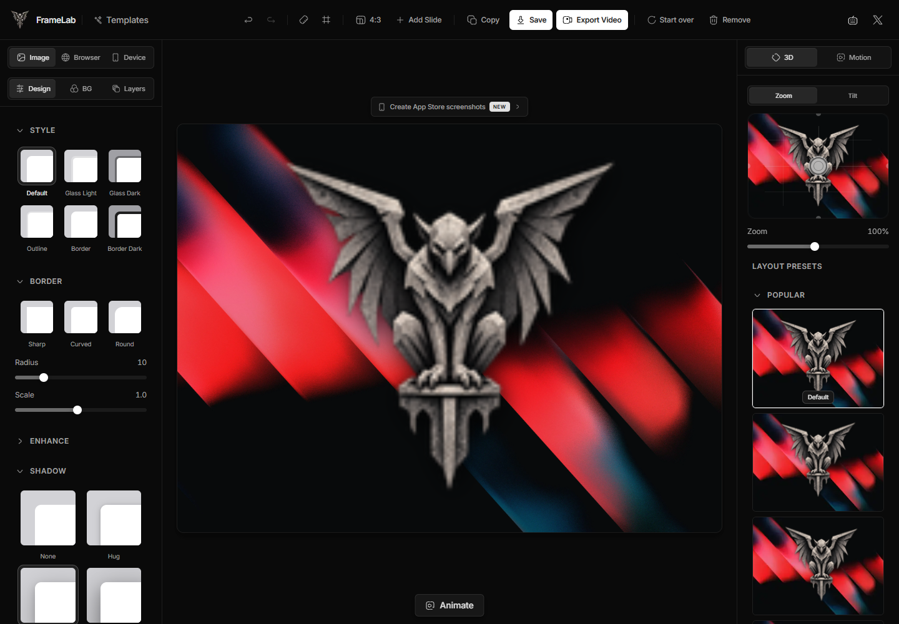

# FrameLab

Make your work look remarkable.

FrameLab is open source under Apache-2.0. Required upstream attribution and legal notices are preserved in `NOTICE`.

Branding uses the owner-provided gargoyle artwork. The unchanged original is `public/branding/original.png`; regenerate derivatives with `node scripts/prepare-framelab-brand.mjs`. Set `NEXT_PUBLIC_SITE_URL` to your actual deployment origin before publishing. No FrameLab deployment has been published.

[Development updates](https://t.me/ErrorEater) · [Contact Developer](https://t.me/VolkovSmirnov) · [GitHub](https://github.com/Lok1Labs) · [X](https://x.com/L0kiLabs)

The editor, export engine, layout, and design tokens are documented in this repository.

<a href="https://vercel.com/oss"></a>



A free, open-source editor for screenshots, mockups, and social graphics. No signup or watermarks.

[Open the editor](http://localhost:3000/editor) · [Image tools](http://localhost:3000/tools) · [Code to image](http://localhost:3000/code) · [App Store screenshots](http://localhost:3000/store-screenshots)

## What you can make

- **Screenshot designs:** backgrounds, browser and device frames, shadows, and 3D perspective.
- **Text-only graphics:** start without an image; choose Inter, Geist, or other fonts, then drag or center your text.
- **Layered compositions:** text, images, annotations, and blur regions.
- **Store and social assets:** ready-made layouts and exact export sizes, including Chrome Web Store screenshots.
- **Images and motion:** PNG, JPEG, WebP, batch ZIP, MP4, WebM, and GIF exports.
- **Quick edits:** resize, crop, convert, compress, and remove image backgrounds.

## Run locally

Requires Node.js 20.9+ and npm.

```bash
cd path/to/framelab
npm ci
printf 'DATABASE_URL="postgresql://localhost:5432/screenshot_studio"\n' > .env
npm run dev
```

Open [localhost:3000](http://localhost:3000). The browser editor needs no running database; `DATABASE_URL` is required by Prisma during startup and builds. Server-side screenshot caching requires PostgreSQL and R2 credentials; see the [cache configuration](./lib/screenshot-cache.ts).

## Contribute

Read [CONTRIBUTING.md](./CONTRIBUTING.md) for the workflow and checks. Built with Next.js, React, TypeScript, Tailwind CSS, and Zustand.

[Apache 2.0 license](./LICENSE) · Supported by the [Vercel OSS Program](https://vercel.com/oss)
